# AI-Based Mining Performance Rating Analysis and Forecasting Using Machine Learning

## 📌 Project Overview

AI-Based Mining Performance Rating Analysis and Forecasting Using Machine Learning is a data-driven project designed to analyze historical mining performance ratings and predict future mining trends using Machine Learning, Artificial Immune System (AIS), and Particle Swarm Optimization (PSO).

The project focuses on analyzing the number of mines achieving 3-star and above ratings and 5-star ratings across different financial years.

The system uses regression models and optimization algorithms to identify historical trends, analyze mining performance, and generate illustrative future predictions.

### Algorithms Implemented

1. Linear Regression
2. Artificial Neural Network (ANN)
3. Artificial Immune System (AIS)
4. Particle Swarm Optimization (PSO)

The project includes data preprocessing, model training, performance evaluation, future forecasting, and visualization.

> **Note:** The dataset contains only three annual observations. Therefore, model evaluation metrics represent training performance rather than independently validated accuracy. Forecasts are illustrative and should not be used for real-world decision-making.

---

## 🎯 Project Objectives

- Analyze historical mining performance ratings.
- Identify trends in 3-star and above rated mines.
- Analyze changes in 5-star rated mines.
- Develop machine learning models for mining performance prediction.
- Implement Artificial Neural Networks for regression analysis.
- Optimize regression coefficients using Artificial Immune System.
- Optimize regression coefficients using Particle Swarm Optimization.
- Compare model training performance.
- Generate illustrative future mining performance predictions.
- Visualize historical trends and model predictions.
- Analyze model errors and optimization convergence.
- Save trained models and prediction results.

---

## 📊 Dataset Description

### Dataset Name

RS_Session_265_AU_1557_A_to_D.csv

### Dataset Information

| Property | Description |
|---|---|
| Domain | Mining Industry |
| Dataset Type | Historical Mining Performance Ratings |
| File Format | CSV |
| Total Records | 3 |
| Original Columns | 3 |
| Input Feature | Financial Year |
| Target Variables | 3-Star and Above Mines, 5-Star Mines |
| Problem Type | Multi-Output Regression |

### Dataset Attributes

| Attribute | Description |
|---|---|
| Year | Financial year |
| No. of 3 Star and above Rated Mines (a) | Number of mines rated 3 stars or above |
| No. of 5 Star Rated Mines out of (a) | Number of mines rated 5 stars |

### Dataset Sample

| Financial Year | 3-Star and Above Mines | 5-Star Mines |
|---|---:|---:|
| 2020-21 | 922 | 40 |
| 2021-22 | 1040 | 76 |
| 2022-23 | 1129 | 68 |

### Dataset Analysis

The number of mines rated 3 stars and above increased from 922 in 2020-21 to 1129 in 2022-23.

The overall increase was approximately 22.45%.

The number of 5-star mines increased from 40 to 76 before decreasing to 68.

These trends provide a basis for descriptive analysis and educational forecasting demonstrations.

---

## 🛠️ Technologies Used

### Programming Language

Python 3.10+

### Libraries

| Library | Purpose |
|---|---|
| NumPy | Numerical computations |
| Pandas | Data preprocessing and analysis |
| Matplotlib | Graph generation |
| Seaborn | Statistical visualization |
| Scikit-learn | Machine learning models and evaluation |
| TensorFlow | Deep learning model implementation |
| Keras | Neural network development |
| Joblib | Model serialization |
| H5py | HDF5 model storage |
| PyYAML | Configuration management |
| JSON | Model metadata storage |

### Development Tools

- Python
- Visual Studio Code
- Jupyter Notebook
- Git
- GitHub

---

# 🧠 Machine Learning Algorithms

## 1. Linear Regression

Linear Regression is a supervised machine learning algorithm used to predict continuous numerical values.

In this project, Linear Regression predicts the number of highly rated mines based on the financial year.

### Mathematical Equation

\[
Y = \beta_0 + \beta_1X
\]

Where:

- Y = Predicted mining performance
- X = Financial year
- β₀ = Intercept
- β₁ = Regression coefficient

### Advantages

- Simple implementation
- Fast training
- Easy interpretation
- Suitable baseline algorithm
- Useful for linear trend analysis

### Model Output

```text
mining_model.pkl
```

---

## 2. Artificial Neural Network (ANN)

Artificial Neural Networks are computational models inspired by biological neural systems.

The ANN learns relationships between input features and output targets using interconnected neurons.

### Neural Network Architecture

| Layer | Neurons | Activation |
|---|---:|---|
| Input Layer | 1 | Input |
| Hidden Layer 1 | 32 | ReLU |
| Hidden Layer 2 | 16 | ReLU |
| Hidden Layer 3 | 8 | ReLU |
| Output Layer | 2 | Linear |

### Training Parameters

| Parameter | Value |
|---|---|
| Optimizer | Adam |
| Learning Rate | 0.001 |
| Loss Function | Mean Squared Error |
| Epochs | 300 |
| Batch Size | 1 |

### Model Output

```text
mining_model.h5
```

The ANN is included for educational comparison. The dataset is too small for meaningful neural network generalization.

---

# 🧬 Artificial Immune System (AIS)

## Overview

Artificial Immune System is a computational intelligence technique inspired by the biological immune system.

This project implements the Clonal Selection Algorithm (CLONALG) to optimize regression coefficients.

Each antibody represents a possible solution to the regression problem.

The algorithm improves candidate solutions using cloning, mutation, and selection.

## AIS Workflow

```text
Start
  |
  v
Initialize Antibody Population
  |
  v
Evaluate Antibody Fitness
  |
  v
Select Elite Antibodies
  |
  v
Clone Selected Antibodies
  |
  v
Apply Hypermutation
  |
  v
Evaluate Mutated Antibodies
  |
  v
Select Best Solutions
  |
  v
Inject Random Antibodies
  |
  v
Repeat for 500 Generations
  |
  v
Select Best Antibody
  |
  v
Generate Predictions
  |
  v
End
```

## AIS Configuration

| Parameter | Value |
|---|---:|
| Population Size | 80 |
| Generations | 500 |
| Elite Antibodies | 15 |
| Clones per Antibody | 10 |
| Mutation Rate | 0.25 |
| Mutation Decay | 0.995 |
| Random Injection | 10 |
| Polynomial Degree | 1 |
| Random Seed | 42 |

## AIS Fitness Function

\[
Fitness = MSE + \lambda R
\]

Where:

- MSE = Mean Squared Error
- λ = Regularization coefficient
- R = Coefficient penalty

The algorithm attempts to minimize fitness.

## AIS Generated Files

```text
ais_model.pkl
ais_model.h5
ais_config.yaml
ais_metadata.json

ais_accuracy_graph.png
ais_heatmap.png
ais_comparison_graph.png
ais_result_graph.png
ais_prediction_graph.png
ais_error_graph.png
ais_convergence_graph.png

ais_result.csv
ais_prediction.csv
ais_metrics.csv
ais_training_history.csv
ais_processed_data.csv
```

---

# 🐦 Particle Swarm Optimization (PSO)

## Overview

Particle Swarm Optimization is a population-based optimization algorithm inspired by the collective movement of birds and fish.

Each particle represents a possible set of regression coefficients.

The particles move through the search space to identify solutions with lower prediction error.

## PSO Workflow

```text
Start
  |
  v
Initialize Particle Population
  |
  v
Initialize Particle Velocities
  |
  v
Evaluate Particle Fitness
  |
  v
Update Personal Best
  |
  v
Update Global Best
  |
  v
Update Particle Velocity
  |
  v
Update Particle Position
  |
  v
Repeat for 500 Iterations
  |
  v
Select Global Best Solution
  |
  v
Generate Predictions
  |
  v
End
```

## PSO Velocity Equation

\[
v_i^{t+1} =
wv_i^t +
c_1r_1(pbest_i-x_i^t) +
c_2r_2(gbest-x_i^t)
\]

Where:

- w = Inertia weight
- c₁ = Cognitive coefficient
- c₂ = Social coefficient
- pbest = Personal best position
- gbest = Global best position

## PSO Position Equation

\[
x_i^{t+1}=x_i^t+v_i^{t+1}
\]

## PSO Configuration

| Parameter | Value |
|---|---:|
| Population Size | 80 |
| Iterations | 500 |
| Inertia Weight | 0.7 |
| Cognitive Coefficient | 1.5 |
| Social Coefficient | 1.5 |
| Maximum Velocity | 0.5 |
| Polynomial Degree | 1 |
| Random Seed | 42 |

## PSO Generated Files

```text
pso_model.pkl
pso_model.h5
pso_config.yaml
pso_metadata.json

pso_accuracy_graph.png
pso_heatmap.png
pso_comparison_graph.png
pso_result_graph.png
pso_prediction_graph.png
pso_error_graph.png
pso_convergence_graph.png

pso_result.csv
pso_prediction.csv
pso_metrics.csv
pso_training_history.csv
pso_processed_data.csv
```

---

# 🔄 Project Methodology

The project follows these stages:

```text
                 START
                   |
                   v
             Load CSV Dataset
                   |
                   v
             Data Preprocessing
                   |
                   v
             Feature Engineering
                   |
                   v
             Data Normalization
                   |
                   v
             Model Development
                   |
        +----------+----------+
        |          |          |
        v          v          v
   ML Models      AIS        PSO
        |          |          |
        v          v          v
    Regression   Clonal     Swarm
    Training     Selection  Optimization
        |          |          |
        +----------+----------+
                   |
                   v
             Model Predictions
                   |
                   v
             Model Evaluation
                   |
                   v
             Future Forecasting
                   |
                   v
             Data Visualization
                   |
                   v
             Save Model Files
                   |
                   v
                  END
```

---

# 📈 Model Evaluation Metrics

The project uses four regression evaluation metrics.

## 1. Mean Absolute Error (MAE)

\[
MAE = \frac{1}{n}\sum_{i=1}^{n}|y_i-\hat{y}_i|
\]

MAE measures the average absolute difference between actual and predicted values.

Lower MAE indicates smaller errors.

## 2. Mean Squared Error (MSE)

\[
MSE = \frac{1}{n}\sum_{i=1}^{n}(y_i-\hat{y}_i)^2
\]

MSE measures the average squared prediction error.

Lower MSE indicates better model fit.

## 3. Root Mean Squared Error (RMSE)

\[
RMSE = \sqrt{MSE}
\]

RMSE measures prediction error in the same units as the target variable.

## 4. R² Score

\[
R^2 = 1 -
\frac{\sum(y_i-\hat{y}_i)^2}
{\sum(y_i-\bar{y})^2}
\]

R² measures how well the regression model fits the observed data.

Higher R² generally indicates better training fit.

R² is not classification accuracy and can be negative.

### Evaluation Limitation

The available dataset contains only three annual observations.

All models are evaluated using the same observations used for training.

Therefore:

- Training R² does not represent independent test accuracy.
- Low training error does not establish reliable forecasting performance.
- Model comparisons are descriptive rather than conclusive.
- Future predictions are illustrative extrapolations.

Additional historical observations are required for reliable out-of-sample evaluation.

---

# 📊 Results and Visualizations

## 1. Model Accuracy Graph

The following graph compares the training R² scores of the baseline regression and neural network models.

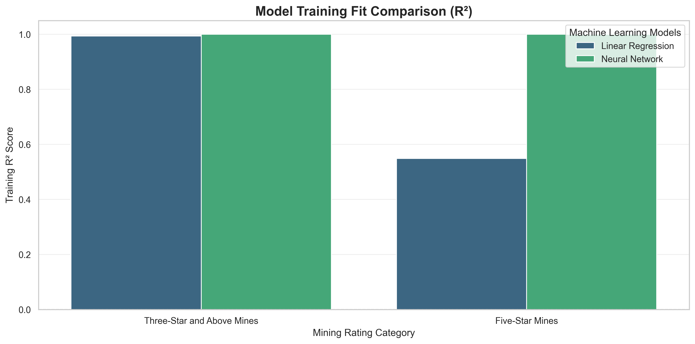

**Figure 1:** Model Training R² Comparison

The graph visualizes model fit for the two mining performance targets.

A higher training R² indicates that the model reproduces the observed historical values more closely.

It does not establish future prediction accuracy.

---

## 2. Correlation Heatmap

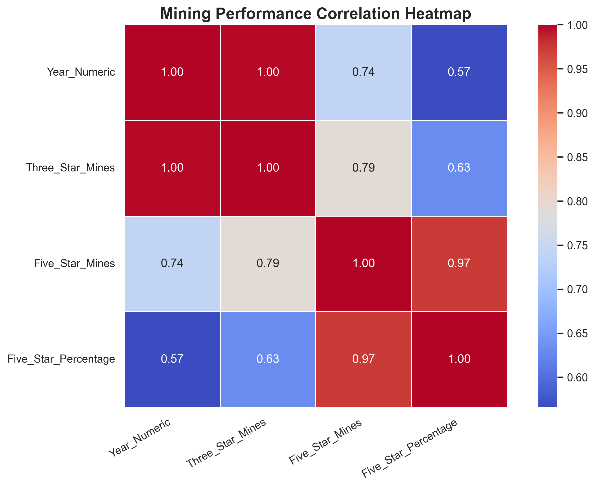

**Figure 2:** Mining Performance Correlation Heatmap

The heatmap visualizes relationships between:

- Financial Year
- 3-Star and Above Mines
- 5-Star Mines
- Percentage of 5-Star Mines

Correlation coefficients range from -1 to +1.

Because the dataset contains only three observations, these correlations should be interpreted cautiously.

---

## 3. Model Comparison Graph

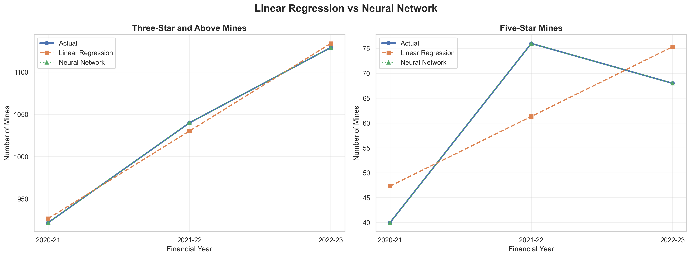

**Figure 3:** Linear Regression vs Neural Network

This graph compares actual mining performance values against predictions generated by Linear Regression and the Artificial Neural Network.

---

## 4. Historical Result Graph

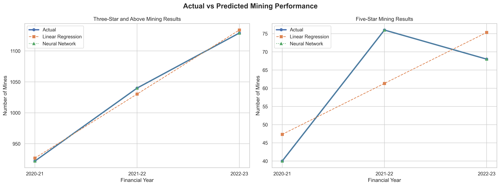

**Figure 4:** Actual vs Predicted Mining Performance

The graph illustrates the differences between observed and model-predicted mining performance ratings.

---

## 5. Future Prediction Graph

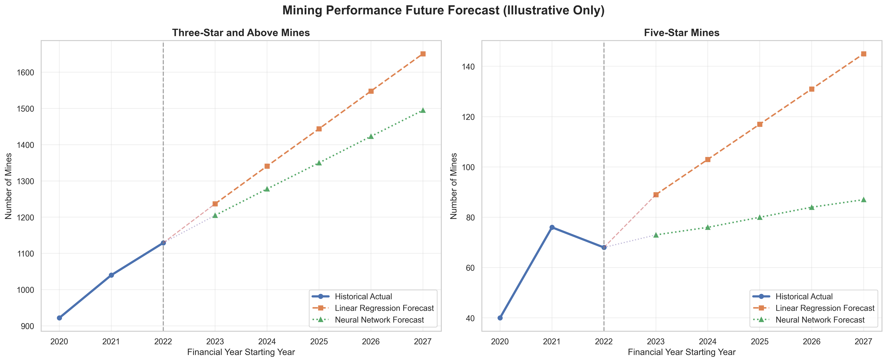

**Figure 5:** Illustrative Mining Performance Forecast

This graph displays historical observations and illustrative forecasts for five future financial years.

Forecast years:

- 2023-24
- 2024-25
- 2025-26
- 2026-27
- 2027-28

---

# 🧬 AIS Visualizations

## AIS Training Fit

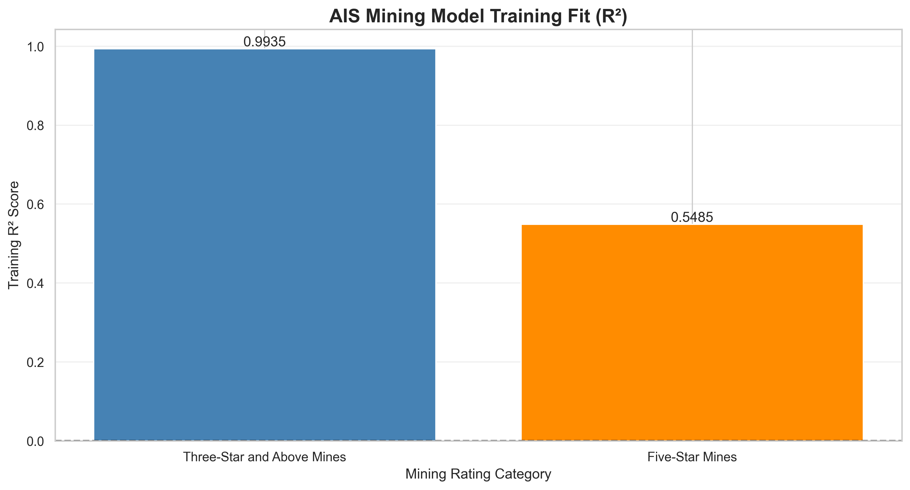

## AIS Correlation Heatmap


## AIS Model Comparison

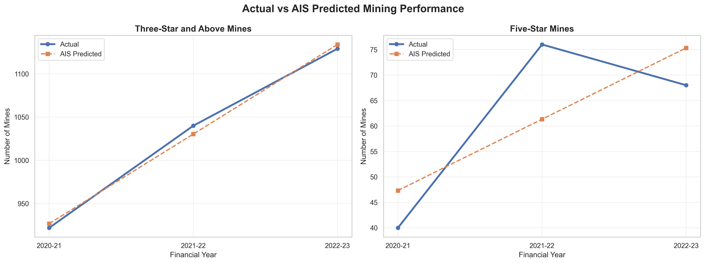

## AIS Historical Results


## AIS Future Predictions

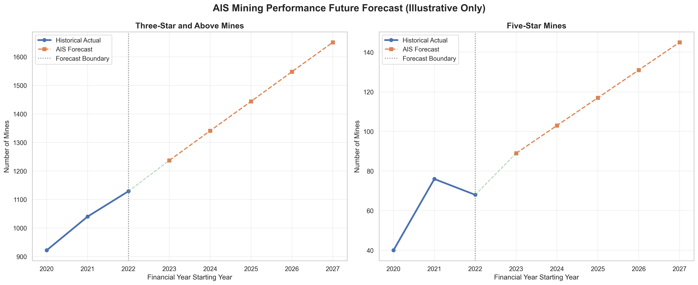

## AIS Training Error


## AIS Optimization Convergence

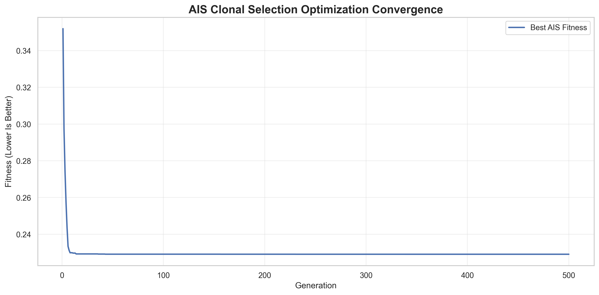

The convergence graph shows changes in the best AIS fitness value over successive generations.

---

# 🐦 PSO Visualizations

## PSO Training Fit

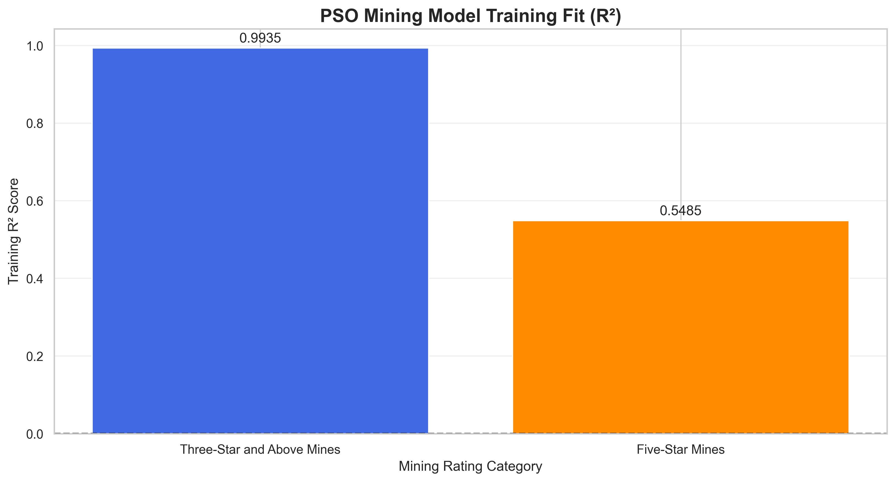

## PSO Correlation Heatmap

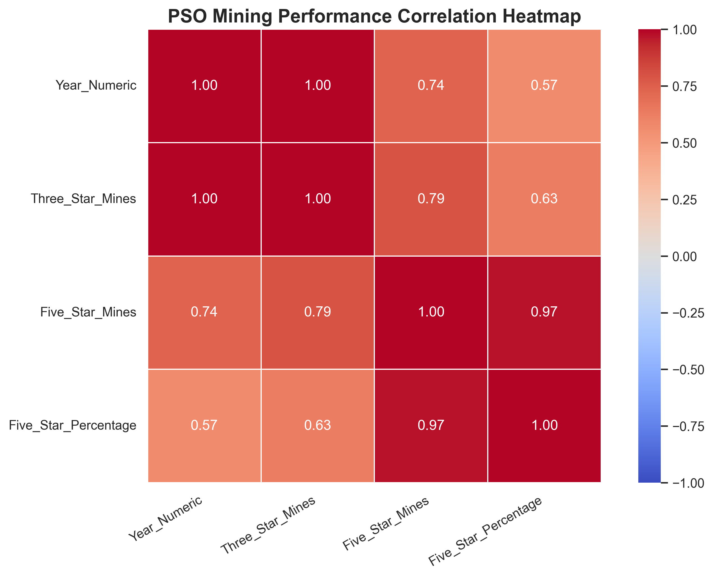

## PSO Model Comparison

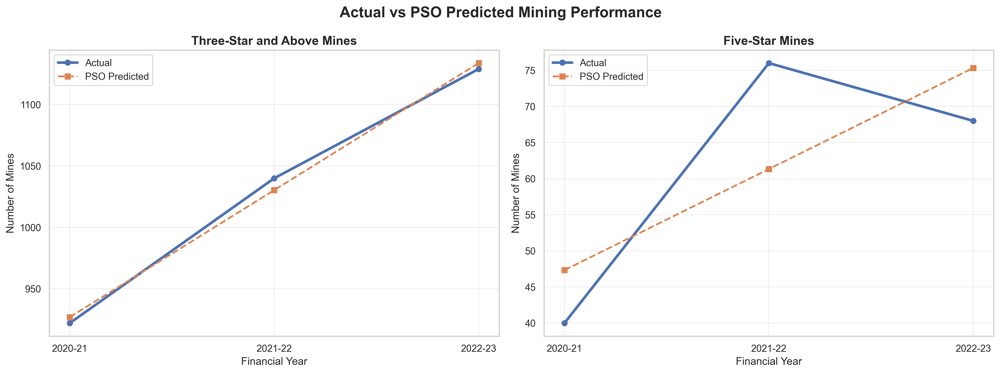

## PSO Historical Results

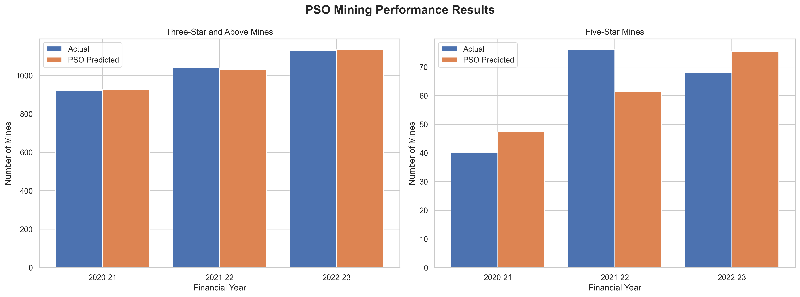

## PSO Future Predictions

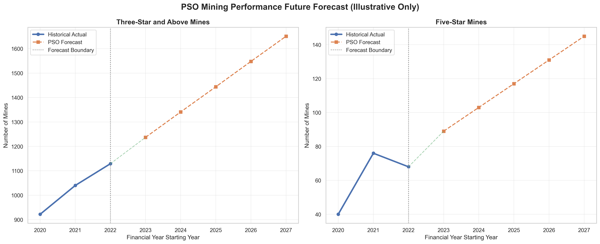

## PSO Training Error

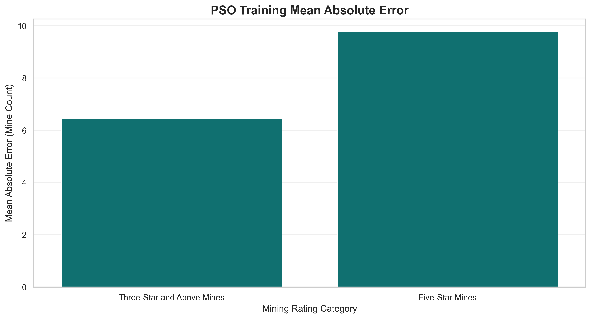

## PSO Optimization Convergence

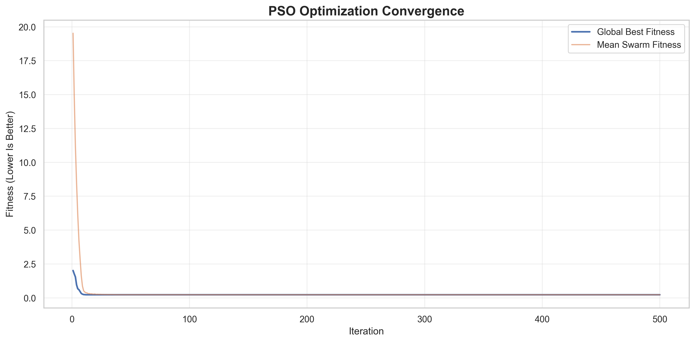

The convergence graph shows how the swarm's best fitness changes during optimization.

---

# 📁 Project Directory Structure

```text
AI-Based Mining Performance Rating Analysis/
│
├── RS_Session_265_AU_1557_A_to_D.csv
│
├── README.md
│
├── mining_model.py
├── mining_visualization.py
├── ais_mining_analysis.py
├── pso_mining_analysis.py
│
├── mining_model.pkl
├── mining_model.h5
├── mining_config.yaml
├── mining_metadata.json
│
├── x_scaler.pkl
├── y_scaler.pkl
│
├── accuracy_graph.png
├── heatmap.png
├── comparison_graph.png
├── result_graph.png
├── prediction_graph.png
├── error_graph.png
│
├── result.csv
├── prediction.csv
├── comparison_metrics.csv
├── processed_mining_data.csv
│
├── ais_model.pkl
├── ais_model.h5
├── ais_config.yaml
├── ais_metadata.json
│
├── ais_accuracy_graph.png
├── ais_heatmap.png
├── ais_comparison_graph.png
├── ais_result_graph.png
├── ais_prediction_graph.png
├── ais_error_graph.png
├── ais_convergence_graph.png
│
├── ais_result.csv
├── ais_prediction.csv
├── ais_metrics.csv
├── ais_training_history.csv
├── ais_processed_data.csv
│
├── pso_model.pkl
├── pso_model.h5
├── pso_config.yaml
├── pso_metadata.json
│
├── pso_accuracy_graph.png
├── pso_heatmap.png
├── pso_comparison_graph.png
├── pso_result_graph.png
├── pso_prediction_graph.png
├── pso_error_graph.png
├── pso_convergence_graph.png
│
├── pso_result.csv
├── pso_prediction.csv
├── pso_metrics.csv
├── pso_training_history.csv
└── pso_processed_data.csv
```

---

# ⚙️ Installation and Setup

## Step 1: Install Python

Install Python 3.10 or a compatible version.

Verify installation:

```bash
python --version
```

## Step 2: Open the Project Directory

```cmd
cd "C:\Users\sagni\Downloads\AI-Based Mining Performance Rating Analysis"
```

## Step 3: Create a Virtual Environment

```bash
python -m venv venv
```

Activate the virtual environment on Windows:

```cmd
venv\Scripts\activate
```

## Step 4: Install Dependencies

```bash
pip install numpy pandas matplotlib seaborn scikit-learn tensorflow joblib pyyaml h5py
```

## Step 5: Verify Dataset Location

Ensure the following file exists:

```text
C:\Users\sagni\Downloads\AI-Based Mining Performance Rating Analysis\RS_Session_265_AU_1557_A_to_D.csv
```

---

# 🚀 How to Run the Project

## 1. Train the Baseline Machine Learning Models

```bash
python mining_model.py
```

This script generates:

- Linear Regression model
- Artificial Neural Network model
- Model configuration
- Model metadata
- Illustrative future predictions

## 2. Generate Machine Learning Visualizations

```bash
python mining_visualization.py
```

This script generates:

- Accuracy graph
- Correlation heatmap
- Comparison graph
- Result CSV
- Result graph
- Prediction CSV
- Prediction graph
- Training error graph

## 3. Run Artificial Immune System

```bash
python ais_mining_analysis.py
```

This script performs:

- AIS population initialization
- Clonal selection
- Hypermutation
- Antibody selection
- Regression coefficient optimization
- Historical prediction
- Future forecasting
- Model evaluation
- Convergence visualization

All generated files use the `ais_` prefix.

## 4. Run Particle Swarm Optimization

```bash
python pso_mining_analysis.py
```

This script performs:

- Particle initialization
- Velocity updates
- Position updates
- Personal best selection
- Global best selection
- Regression coefficient optimization
- Historical prediction
- Future forecasting
- Model evaluation
- Convergence visualization

All generated files use the `pso_` prefix.

---

# 📄 Generated CSV Files

## 1. result.csv

Contains historical mining performance values and predictions from the baseline machine learning models.

### Main Columns

```text
Year
Actual_Three_Star_Mines
LR_Three_Star_Prediction
NN_Three_Star_Prediction
Actual_Five_Star_Mines
LR_Five_Star_Prediction
NN_Five_Star_Prediction
```

Additional columns contain absolute prediction errors.

## 2. prediction.csv

Contains illustrative future predictions from Linear Regression and the Artificial Neural Network.

### Main Columns

```text
Year
LR_Three_Star_Mines
NN_Three_Star_Mines
LR_Five_Star_Mines
NN_Five_Star_Mines
```

## 3. ais_result.csv

Contains historical actual values, AIS predictions, and absolute prediction errors.

## 4. ais_prediction.csv

Contains five-year illustrative forecasts generated by the AIS-optimized regression model.

## 5. pso_result.csv

Contains historical actual values, PSO predictions, and absolute prediction errors.

## 6. pso_prediction.csv

Contains five-year illustrative forecasts generated by the PSO-optimized regression model.

---

# 💾 Model Files

## Machine Learning Models

```text
mining_model.pkl
mining_model.h5
```

The `.pkl` file contains the trained Linear Regression model.

The `.h5` file contains the trained Artificial Neural Network.

## AIS Models

```text
ais_model.pkl
ais_model.h5
```

These files store the AIS-optimized regression model and its parameters.

The AIS `.h5` file uses HDF5 storage and is not a Keras model.

## PSO Models

```text
pso_model.pkl
pso_model.h5
```

These files store the PSO-optimized regression model and its parameters.

The PSO `.h5` file uses HDF5 storage and is not a Keras model.

---

# 📉 Model Comparison

The project supports comparison of the following approaches:

| Algorithm | Model Type | Optimization Technique |
|---|---|---|
| Linear Regression | Statistical Regression | Least Squares |
| ANN | Neural Network | Adam Optimizer |
| AIS | Regression | Clonal Selection |
| PSO | Regression | Particle Swarm Optimization |

### Comparison Criteria

- Mean Absolute Error
- Mean Squared Error
- Root Mean Squared Error
- R² Score
- Training convergence
- Historical prediction fit

The algorithms should be compared using the same targets and evaluation methodology.

### Important Consideration

The available dataset is insufficient for a statistically meaningful comparison of generalization performance.

A lower training error does not necessarily indicate that an algorithm will produce better future forecasts.

---

# 🔮 Future Prediction

The system generates illustrative mining performance predictions for the following financial years:

| Financial Year | Prediction |
|---|---|
| 2023-24 | Illustrative Forecast |
| 2024-25 | Illustrative Forecast |
| 2025-26 | Illustrative Forecast |
| 2026-27 | Illustrative Forecast |
| 2027-28 | Illustrative Forecast |

The forecasting models estimate:

1. Number of 3-star and above rated mines.
2. Number of 5-star rated mines.

The AIS and PSO scripts also calculate the predicted percentage of 5-star mines among 3-star and above rated mines.

Predicted mine counts are rounded to nonnegative integers, with 5-star counts constrained not to exceed 3-star and above counts.

These predictions are illustrative rather than validated forecasts.

---

# 🌍 Applications

Potential applications of a mining performance analytics system include:

### 1. Mining Performance Monitoring

Analyze changes in mining performance ratings over time.

### 2. Mining Industry Research

Support exploratory research into historical mining performance patterns.

### 3. Policy Analysis

Provide descriptive information that may support further evaluation of mining performance policies.

### 4. Data-Driven Planning

Demonstrate how forecasting systems could support planning when sufficient historical data becomes available.

### 5. Computational Intelligence Research

Compare traditional regression with nature-inspired optimization algorithms.

### 6. Educational Applications

Demonstrate:

- Regression modeling
- Neural networks
- Artificial Immune Systems
- Particle Swarm Optimization
- Model evaluation
- Data visualization
- Forecast generation

---

# ⚠️ Project Limitations

The project has several limitations.

### 1. Limited Dataset Size

Only three annual observations are available.

This is insufficient for reliable model validation.

### 2. Limited Input Features

The models primarily use financial year as the input feature.

Other potentially relevant variables are not included.

### 3. Risk of Overfitting

Complex models such as neural networks may fit the historical observations without learning generalizable relationships.

### 4. Forecasting Uncertainty

Future mining performance may be influenced by factors not represented in the dataset.

### 5. Training-Based Evaluation

Reported model metrics are calculated using observations included in model training.

They do not establish out-of-sample predictive accuracy.

### 6. Limited Algorithm Comparison

AIS and PSO optimize regression coefficients, but the small dataset does not provide sufficient evidence to determine whether either method outperforms standard regression.

---

# 🚀 Future Enhancements

Potential future improvements include:

- Collecting additional historical mining rating data.
- Incorporating mine-level records.
- Adding geographical and operational features.
- Implementing chronological train-test evaluation.
- Performing walk-forward validation.
- Adding uncertainty intervals to forecasts.
- Developing an interactive Streamlit dashboard.
- Implementing additional optimization algorithms.
- Comparing Random Forest and Gradient Boosting models.
- Integrating external mining industry datasets.
- Developing a web-based prediction interface.
- Creating automated model performance reports.

---

# 📌 Expected Outcomes

The project demonstrates the development of a mining performance analysis system using machine learning and computational intelligence techniques.

Expected educational outcomes include:

1. Understanding historical mining performance trends.
2. Implementing multi-output regression.
3. Developing an Artificial Neural Network.
4. Implementing Artificial Immune System optimization.
5. Implementing Particle Swarm Optimization.
6. Calculating regression performance metrics.
7. Generating and interpreting visualizations.
8. Saving trained models and configuration files.
9. Producing illustrative future predictions.
10. Understanding the limitations of small datasets.

---

# 🏁 Conclusion

The AI-Based Mining Performance Rating Analysis and Forecasting project demonstrates how Machine Learning, Artificial Immune System, and Particle Swarm Optimization can be applied to historical mining performance data.

Linear Regression provides an interpretable baseline, while the Artificial Neural Network demonstrates a deep learning approach.

AIS and PSO provide alternative optimization techniques for selecting regression coefficients.

The project generates historical predictions, illustrative future forecasts, evaluation metrics, and multiple visualizations.

Although the current dataset is too small for reliable forecasting, the implementation provides a foundation for future research and development using larger mining datasets.

---

# 📚 Keywords

Artificial Intelligence, Machine Learning, Mining Performance Analysis, Mining Star Ratings, Linear Regression, Artificial Neural Network, Artificial Immune System, AIS, Clonal Selection Algorithm, Particle Swarm Optimization, PSO, Regression, Forecasting, Data Analytics, Computational Intelligence, Python, Predictive Modeling.

---

# 📜 License

This project is intended for educational and research purposes.

Any reuse or redistribution of the original dataset must comply with the dataset provider's applicable terms.

---

# ⭐ Project Summary

| Component | Details |
|---|---|
| Project Name | AI-Based Mining Performance Rating Analysis |
| Domain | Artificial Intelligence and Machine Learning |
| Programming Language | Python |
| Dataset | Historical Mining Performance Ratings |
| Prediction Type | Multi-Output Regression |
| Algorithms | Linear Regression, ANN, AIS, PSO |
| Optimization Methods | Clonal Selection, Particle Swarm Optimization |
| Evaluation Metrics | MAE, MSE, RMSE, R² |
| Forecast Period | Five Financial Years |
| Visualizations | Accuracy, Heatmap, Comparison, Results, Predictions, Errors, Convergence |
| Model Formats | PKL, H5 |
| Configuration Formats | YAML, JSON |
| Output Formats | CSV, PNG |
| Application | Mining Performance Analysis and Educational Forecasting |

---

**AI-Based Mining Performance Rating Analysis and Forecasting Using Machine Learning**

*An educational implementation of regression modeling and nature-inspired optimization for mining performance analytics.*
